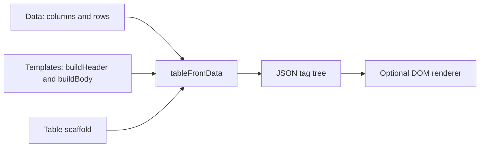

# v12 guide and API reference

This guide describes the implementation under [`src/v12`](../src/v12). The package entry [`src/index.js`](../src/index.js) re-exports that version. Historical source folders are outside this guide.

[Back to the project README](../README.md) · [v12 samples](../samples/README.md)

## The model

This repository focuses on table construction. It takes column metadata, row records, reusable header and cell templates, and an outer table scaffold, then assembles a consistent table tree. That separation is useful when table data changes while its layout stays the same, or when an application needs to define its own header, cell, and styling structure. A separate renderer can turn the resulting JSON tag tree into browser DOM nodes.



The three inputs have separate jobs:

- **Data** supplies the column contexts and row values.
- **Templates** define the tag objects to clone and fill.
- **The scaffold** defines the outer table and its styling.

The result remains ordinary JavaScript data. The transformer does not create or append DOM elements.

## Install and import

```bash
npm install json-transformer-funcs
```

Use named imports from the package:

```js
import {
  tableFromData,
  buildTable,
  collectionFromKey,
  collectionFromInternal,
  collectionFromArray,
  defaultSpec,
  defaultTable
} from "json-transformer-funcs";
```

The repository entry can also be imported directly:

```js
import { tableFromData } from "../src/index.js";
```

The implementation uses ES modules and the platform `structuredClone` function.

## Quick start

```js
import { tableFromData } from "json-transformer-funcs";

const inData = {
  columns: [
    { columnName: "Product" },
    { columnName: "Price" }
  ],
  rows: [
    { product: "Drill bit", price: "$12.50" },
    { product: "End mill", price: "$89.00" }
  ]
};

const tableTree = tableFromData({ inData });
```

With no custom `inSpec` or `inTable`, v12 uses [`defaultSpec`](../src/v12/tableFromData/index.js) and [`defaultTable`](../src/v12/tableFromData/index.js). The generated header texts are `Product` and `Price`; each row becomes a `tr` containing one `td` per row value.

## Input contract

### Data

`inData` must be an object with two arrays:

```js
const inData = {
  columns: [
    { columnName: "Product" },
    { columnName: "Price" }
  ],
  rows: [
    { product: "Drill bit", price: "$12.50" }
  ]
};
```

`columns` is mapped through the header template. `rows` is mapped into body rows. For body generation, `collectionFromInternal` reads each row using `Object.values`; therefore, the order of each row's values must match the order of the displayed columns.

### Specification

The default specification is equivalent to:

```js
const inSpec = {
  buildHeader: {
    tagName: "th",
    textContent: "${columnName}"
  },
  buildBody: {
    outerTemplate: { tagName: "tr" },
    innerTemplate: {
      tagName: "td",
      textContent: "${rowValue}"
    }
  }
};
```

A custom specification passed to `tableFromData` must contain `buildHeader` and `buildBody.outerTemplate` / `buildBody.innerTemplate`.

### Table scaffold

The default scaffold has a table root, a direct `thead` child with a first `tr`, and a direct `tbody` child. A custom `inTable` must provide that same structure. `tableFromData` puts generated headers in the first `thead` row and replaces the `tbody` children with generated rows. Other scaffold nodes, such as a `colgroup` or `tfoot`, are retained but are not populated automatically.

## Placeholder rules

Use `${propertyName}` in a string. v12 replaces every matching token in the string, including when the token appears after other text:

```js
const template = {
  tagName: "input",
  attributes: {
    placeholder: "Enter ${columnName}",
    name: "${columnName}",
    class: "field-${fieldType}"
  }
};
```

The replacement runs in string templates, `textContent`, attribute values, and string children. It does not rewrite structural fields such as `tagName`. Placeholder names may contain letters, digits, and underscores (`\w+`); dotted paths such as `${row.name}` are not supported. If a property is missing, its token stays in the output. A plain dollar amount such as `$12.50` is unchanged because it is not a `${name}` token.

The value is looked up directly on the current context object. Non-string values are converted to strings by JavaScript's string replacement behavior. The transformer does not sanitize HTML, URLs, or attribute values; apply the security rules appropriate to the renderer that consumes the result.

## API reference

### `tableFromData({ inData, inSpec, inTable })`

Builds the table tree.

| Argument | Required | Meaning |
| --- | --- | --- |
| `inData` | Yes | Object with `columns` and `rows` arrays. |
| `inSpec` | No | Header/body templates. Defaults to `defaultSpec` when omitted or falsy. |
| `inTable` | No | Table scaffold. Defaults to `defaultTable` when omitted or falsy. |

Returns a cloned table scaffold with generated header and body children. `buildTable` is an alias for this function.

### `collectionFromKey(inSource, inTemplate)`

Maps `inTemplate` over `inSource`. For each array item, placeholders are resolved against that item. This is used for headers and can also build column groups, footers, or other repeated structures.

```js
const headers = collectionFromKey(
  [{ columnName: "Product" }, { columnName: "Price" }],
  { tagName: "th", textContent: "${columnName}" }
);
```

### `collectionFromInternal(inSource, outerTemplate, innerTemplate)`

Maps an array of row objects into outer nodes. For every value in each row, it creates one cloned inner template and supplies `{ rowValue: value }` as the replacement context. The generated inner nodes replace the outer template's `children`.

```js
const rows = collectionFromInternal(
  [{ product: "Drill bit", price: "$12.50" }],
  { tagName: "tr" },
  { tagName: "td", textContent: "${rowValue}" }
);
```

This helper uses row value order; it does not match cells to column names.

### `defaultSpec` and `defaultTable`

Exported starter objects used by `tableFromData`. Pass custom versions to control the tags, text, attributes, and scaffold classes.

### `collectionFromArray(inSource, inTemplate)`

This name is present in the v12 exports, but its implementation is currently a stub and returns `undefined`. It is not a working collection builder yet.

## Template application details

The internal template applier clones its input with `structuredClone`, then processes supported fields recursively:

- A string value is passed through placeholder replacement.
- `textContent` is replaced using the current data context.
- Each attribute value is processed using the same context.
- Each item in `children` is processed recursively.
- Other primitive values are returned as-is.

Templates and scaffolds are not modified in place. `tableFromData` also clones the scaffold before filling it.

## Output shape

For the quick-start data, the generated portions have this shape:

```json
{
  "tagName": "table",
  "children": [
    {
      "tagName": "thead",
      "children": [
        {
          "tagName": "tr",
          "children": [
            { "tagName": "th", "textContent": "Product" },
            { "tagName": "th", "textContent": "Price" }
          ]
        }
      ]
    },
    {
      "tagName": "tbody",
      "children": [
        {
          "tagName": "tr",
          "children": [
            { "tagName": "td", "textContent": "Drill bit" },
            { "tagName": "td", "textContent": "$12.50" }
          ]
        }
      ]
    }
  ]
}
```

The actual default scaffold also includes its default attributes and classes.

## Rendering

The compiled value is a JSON tag description, not a DOM node. A compatible renderer such as [`json-to-tag`](https://github.com/keshavsoft/json-to-tag) can consume it:

```js
const tableTree = tableFromData({ inData });
const tableElement = buildSpecElement(tableTree);
document.querySelector("#table-host").appendChild(tableElement);
```

The renderer is a separate dependency and is not called by this package.

For the separate user, contributor, and architecture guides, open the [documentation index](index.html). This Markdown page remains the detailed API reference. Serve the repository over HTTP (for example, with `npm run dev`) so the browser can load JavaScript modules.

## Current constraints

- `tableFromData` expects direct `thead` and `tbody` children and a first header row.
- `collectionFromInternal` uses each row's property enumeration order, not column names.
- The table builder fills the header and body only; custom structures such as footers need to be built separately.
- `collectionFromArray` is exported but unfinished.
- Placeholder replacement is a small string substitution feature, not a JavaScript expression evaluator.

## Source map

| Concern | v12 source |
| --- | --- |
| Named exports | [`src/v12/index.js`](../src/v12/index.js) |
| Table orchestration and defaults | [`src/v12/tableFromData/index.js`](../src/v12/tableFromData/index.js) |
| Template cloning and traversal | [`src/v12/applyTemplate/index.js`](../src/v12/applyTemplate/index.js) |
| Placeholder replacement | [`src/v12/applyTemplate/commonReplace.js`](../src/v12/applyTemplate/commonReplace.js) |
| Repeated headers/collections | [`src/v12/collectionFromKey/index.js`](../src/v12/collectionFromKey/index.js) |
| Repeated rows/cells | [`src/v12/collectionFromInternal/index.js`](../src/v12/collectionFromInternal/index.js) |

## Samples

There are four top-level v12 sample cases: `columns`, `rows`, `rows_good`, and `html`. They show column-driven parts, row repetition, instruction-based assembly, and the browser rendering step. Some fixtures are exploratory rather than complete: the `columns` header/footer paths miss the row index, while the row cases select a plain `<tr>` template and therefore leave generated rows without cells. The nested `html/buildSpec` case fills header and footer slots; it does not fill the colgroup or body.

The [documentation index](index.html) links to a separate architecture guide that traces how collection helpers, sample instructions, and scaffold insertion points connect. See the [v12 sample map](../samples/README.md) for links to every case.
